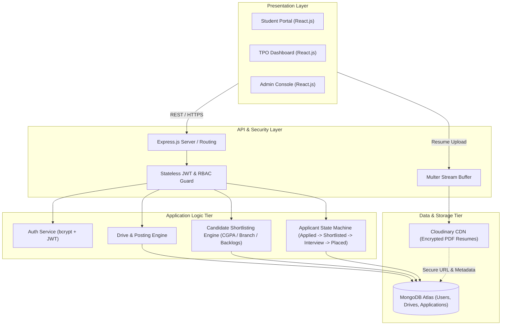

# High-Level System Architecture (HLD)

## Overview
The College Placement Management System (CPMS) decouples user interaction, business logic, asynchronous file handling, and persistence into distinct tiers.

## Architectural Layers
1. Presentation Layer: React Single Page Application (SPA) with role-guarded routes.
2. Security & Middleware: Stateless JWT verification and 3-tier Role-Based Access Control (Student, TPO, Admin).
3. Application Tier: Node.js & Express REST services handling placement business rules.
4. Persistence Tier: MongoDB Atlas with compound indexes for fast query execution and unique constraints.
5. Asset Storage: Cloudinary CDN for offloading PDF storage and delivery.